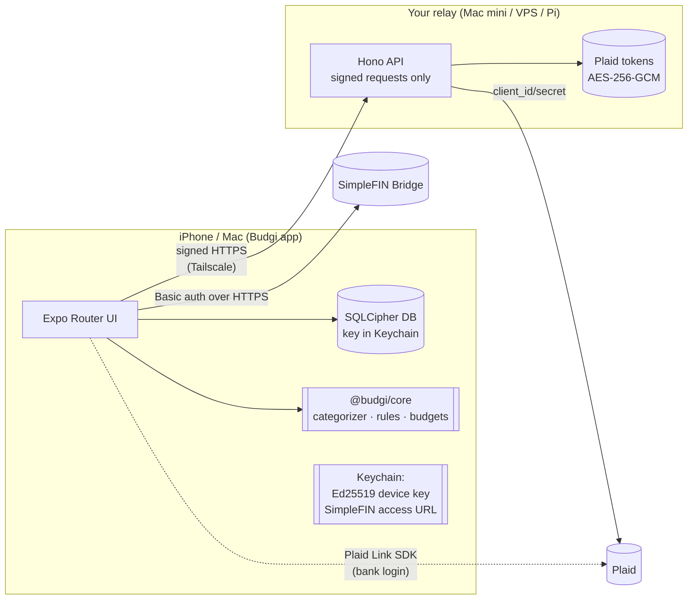

# Budgi

A minimal, fast, private budgeting app for iPhone (and Apple Silicon Macs).
Budgi connects to your banks, sorts every transaction into a category on its
own, and lets you write rules for whatever it gets wrong. Everything stays
encrypted on your phone, behind Face ID.

<p align="center">
  
  
  
  
</p>
<p align="center">
  
  
  
</p>

<sub>Screenshots are from the web preview build with demo data. On iOS the
app uses SF Symbols, the native tab bar (Liquid Glass on iOS 26), native
large titles and search, and native form sheets.</sub>

## What it does

- **Automatic categorization out of the box.** A pipeline of six layers, each
  with a confidence score: your manual choices → your rules → what Budgi
  learned from your past corrections → ~380 known merchant patterns (Uber Eats isn't
  Uber; Amazon Prime isn't Amazon shopping) → the bank's or Plaid's own
  category → keyword guesses ("PIZZERIA" → Dining). Messy descriptors like
  `SQ *BLUE BOTTLE COFFE 0123 OAKLAND CA` are cleaned to `Blue Bottle Coffee`.
  The demo data comes out about 98% categorized.
- **Rules.** Match on merchant or description (contains, is, starts or ends
  with, regex), amount (over, under, between), money in/out, account, or bank
  category, combined with all/any. A rule can set the category, rename the
  merchant, exclude it from budgets, or mark it reviewed. Rules show a live
  preview of matching transactions as you edit, run top to bottom, and can be
  reordered. Deleting a rule cleanly undoes what it did.
- **"Always do this?"** When you change a category, Budgi offers to turn it
  into a rule and apply it to the similar transactions too, in one tap.
- **Review inbox.** New transactions Budgi isn't sure about go to a swipeable
  card deck: swipe right if it looks right, or tap a category. Confident
  results skip the inbox, so it stays short. On first import, only the last
  week (plus anything unknown) needs review, not months of history.
- **Budgets that understand rent.** Fixed costs (housing, bills, insurance,
  subscriptions) count as expected from day one. The "flexible / day" number
  shows what you can actually still choose to spend. One tap suggests every
  budget from the median of your last three months.
- **Home.** Spend so far with a rolling-digit counter, a cumulative chart of
  this month against last month and your budget pace (scrub it to see any
  day), where your money went, subscriptions and bills due soon, and net
  worth.
- **Subscription detection.** Weekly, biweekly, monthly, quarterly and yearly
  charges are found automatically, and ones that look cancelled are flagged.
- **Fast.** FlashList v2 for the feed. Animations run on the UI thread
  (Reanimated 4). The app opens from a local database, then syncs in the
  background.

## Security in one paragraph

Your bank password only ever goes to your bank, inside Plaid or SimpleFIN.
Transactions are stored only on your phone, in a SQLCipher-encrypted database
whose key is in the iOS Keychain (this device only, excluded from backups),
behind Face ID. The app is blurred in the app switcher. For Plaid, a tiny relay
you host holds the API keys and the bank tokens, encrypted with AES-256-GCM. It
stores **no transactions**, and it only accepts requests signed by the
Ed25519 key of a device you paired with a one-time code. Read the
[full security model](docs/SECURITY.md).

## Architecture



```
packages/core   Pure TypeScript domain logic shared by app and server
                (merchant cleaning + knowledge base, categorizer, rules engine,
                budgets/pace, recurring detection, Plaid/SimpleFIN mappers,
                pending→posted merging, request signing). 57 unit tests.
apps/server     Plaid relay: Hono + node:sqlite, zero native deps. 12 tests.
apps/mobile     Expo SDK 57 / React Native 0.86 app (iOS-first; web = preview).
```

## Quick start (no bank needed)

```bash
npm install
npm run web -w @budgi/mobile          # preview in a browser, choose “Explore with demo data”
```

## Run it on your iPhone

Plaid Link, SQLCipher and Face ID are native modules, so use a development
build rather than Expo Go. On a Mac with a recent Xcode:

```bash
npm install
cd apps/mobile
npx expo run:ios --device             # pick your iPhone; a free Apple ID works (7-day signing)
```

For a build that doesn't expire, use an Apple Developer account and
`npx eas build --platform ios` (or Archive in Xcode), then install through
TestFlight.

**On your Mac:** Apple Silicon Macs run the iOS app natively. In Xcode, choose
**My Mac (Designed for iPad)** as the run destination, or install it from
TestFlight on the Mac.

## Connect your accounts

Budgi supports two bank-data providers. Use either or both.

### Option A: SimpleFIN Bridge (no server, about $15/year)

The simplest private option, and a favorite of the self-hosting community
(Actual Budget uses it too). Read-only, and you control it.

1. Create an account at [beta-bridge.simplefin.org](https://beta-bridge.simplefin.org) and connect your banks there.
2. Create a new app connection and copy the **Setup Token**.
3. In Budgi, go to **Settings → Accounts → SimpleFIN Bridge**, paste the token,
   and tap **Connect**.

The token is exchanged once for a private access URL, which is stored only in
your Keychain. SimpleFIN data refreshes about once a day.

### Option B: Plaid, through your private relay

Plaid covers 12,000+ institutions with near-real-time pending transactions.
It needs a server, because Plaid's API secret must never ship inside an app.

1. **Get Plaid keys.** Sign up at [dashboard.plaid.com](https://dashboard.plaid.com/signup)
   and choose **Personal use**. That gives you the free Trial plan with real
   bank access (limited number of connected banks). Use `sandbox` first to try
   it (log in with `user_good` / `pass_good`).
2. **Configure the relay.**
   ```bash
   cp apps/server/.env.example apps/server/.env
   npm run cli -w @budgi/server keygen   # paste the output into BUDGI_MASTER_KEY
   # fill PLAID_CLIENT_ID, PLAID_SECRET, PLAID_ENV in apps/server/.env
   ```
3. **Run it** on an always-on machine (Mac mini, Raspberry Pi, small VPS):
   ```bash
   npm run server                        # dev (auto-reload)
   # or: docker build -f apps/server/Dockerfile -t budgi-relay . && \
   #     docker run -d --env-file apps/server/.env -v budgi:/data -p 127.0.0.1:8787:8787 budgi-relay
   ```
4. **Make it reachable privately.** With [Tailscale](https://tailscale.com) on
   the server and your phone, run `tailscale serve --bg 8787`. You get
   `https://<machine>.<tailnet>.ts.net`, which only your devices can reach. Set
   that as `PUBLIC_URL`.
5. **Pair your phone:** run `npm run server:pair`, then in Budgi go to
   **Settings → Relay server → Scan pairing code**.
6. In Budgi, go to **Settings → Accounts → Bank or card via Plaid** and sign in
   to your bank inside Plaid Link.

Banks that use OAuth (Chase and others) also need `PLAID_REDIRECT_URI`, set to
a universal link you control and registered in the Plaid dashboard.

Relay CLI: `npm run cli -w @budgi/server devices` (also `revoke <id>`, `items`, `keygen`).

## Why these choices

I chose the stack after looking at what people building finance apps
recommend, and at the most-praised apps (Copilot, Monarch, YNAB, Actual
Budget):

| Need | Choice | Why |
| --- | --- | --- |
| iOS + Mac app you can actually build and iterate on | **Expo SDK 57 / RN 0.86, new architecture** | Native UIKit tab bar, sheets, large titles and SF Symbols through `expo-router` and `expo-symbols`, while the logic stays shared TypeScript. The app also runs on Apple Silicon Macs. |
| Liquid Glass / native feel | `NativeTabs`, `expo-glass-effect`, native `formSheet` presentations | These use the real system components, so they feel right instead of imitating iOS. |
| Animation | **Reanimated 4 + Gesture Handler** | UI-thread springs for the rolling digits, chart draw-in and scrubbing, swipe-to-review deck, swipe actions and progress bars. Haptics on every meaningful interaction. |
| Charts | `react-native-svg` + Reanimated (monotone cubic curves) | Small, scrubbable and themeable; no extra 3 MB Skia runtime for one chart. |
| Long lists | **FlashList v2** | Recycling and sticky day headers keep thousands of transactions smooth. |
| State | Zustand | Tiny and synchronous, with selectors to limit re-renders. |
| Storage | `expo-sqlite` with **SQLCipher** | Encrypted at rest, with the key in the Keychain. |
| Bank data | **Plaid** (through a relay) and **SimpleFIN** | Plaid has the best coverage, and its "Personal use" Trial plan is the route for individuals; new Limited Production sign-ups closed for US/Canadian developers in April 2026. SimpleFIN needs no server and is popular with the privacy-minded self-hosting crowd. |
| Categorization UX | Confidence + review inbox + "always?" rules | From the Copilot vs. Monarch debate: AI-style auto-categorization plus transparent rules, with the *why* shown on every transaction. |

## Development

```bash
npm test             # core + server unit tests (vitest)
npm run typecheck    # all three packages
npm run mobile       # Expo dev server for the development build
```

## Roadmap ideas

- Split transactions, and household sharing through an end-to-end encrypted sync blob on the relay
- Plaid webhooks → silent push for instant transaction alerts
- Home-screen widget (spend today, left to spend) with `expo-widgets`
- CSV import/export, and a custom category editor
- Investment holdings and a net-worth history chart
