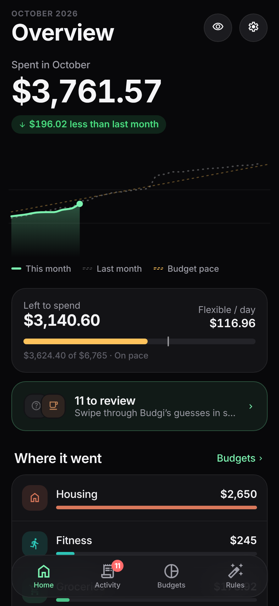
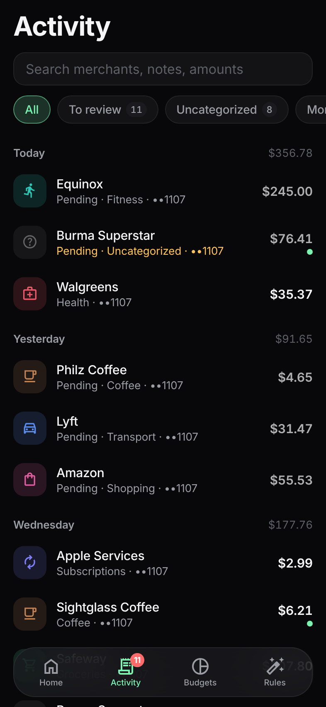
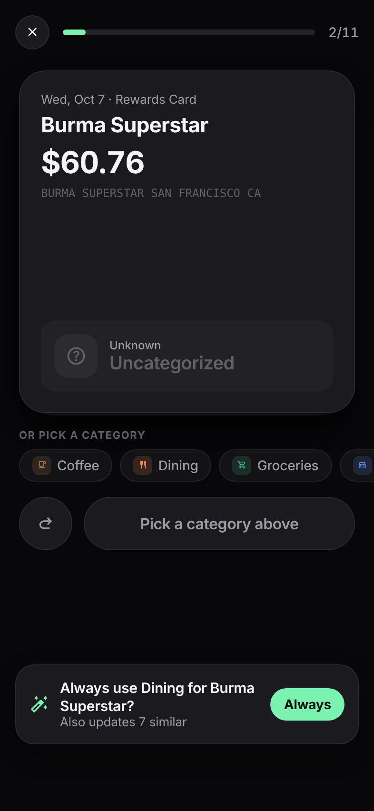
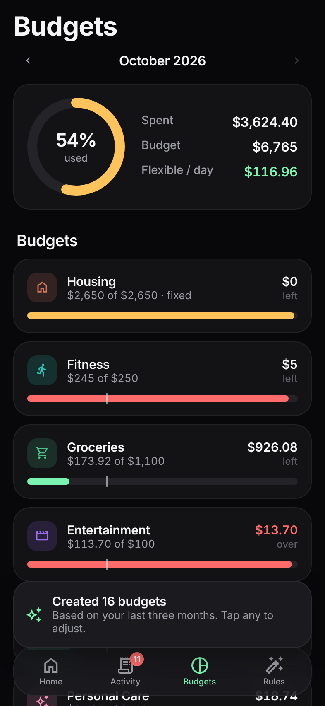
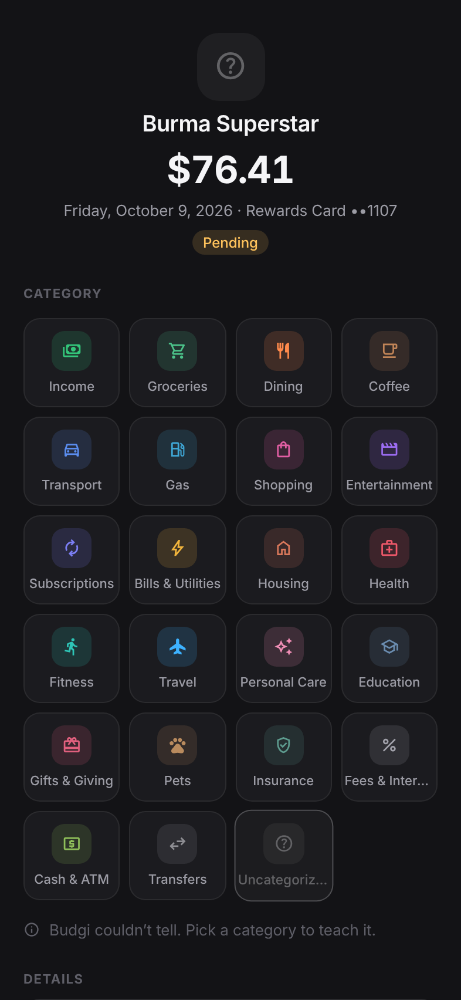
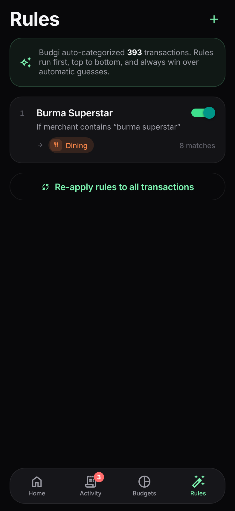
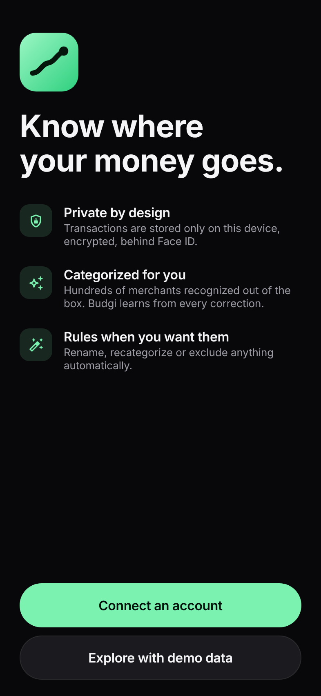
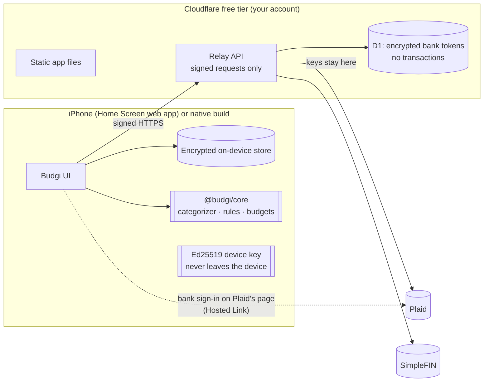

# Budgi

A minimal, fast, private budgeting app for iPhone and Mac. Budgi connects to
your banks, sorts every transaction into a category on its own, and lets you
write rules for whatever it gets wrong. Everything stays encrypted on your
device, behind Face ID. Install it free from Safari, with no App Store and no
Xcode.

<p align="center">
  
  
  
  
</p>
<p align="center">
  
  
  
</p>

<sub>Screenshots use demo data. The optional native iOS build swaps in SF
Symbols, the Liquid Glass tab bar, and native sheets and large titles.</sub>

## What it does

- **Automatic categorization out of the box.** A pipeline of six layers, each
  with a confidence score: your manual choices → your rules → what Budgi
  learned from your past corrections → ~380 known merchant patterns (Uber Eats isn't
  Uber; Amazon Prime isn't Amazon shopping) → the bank's or Plaid's own
  category → keyword guesses ("PIZZERIA" → Dining). Messy descriptors like
  `SQ *BLUE BOTTLE COFFE 0123 OAKLAND CA` are cleaned to `Blue Bottle Coffee`.
  The demo data comes out about 98% categorized.
- **Rules.** Match on merchant or description (contains, is, starts or ends
  with, regex), amount (over, under, between), money in/out, account, or bank
  category, combined with all/any. A rule can set the category, rename the
  merchant, exclude it from budgets, or mark it reviewed. Rules show a live
  preview of matching transactions as you edit, run top to bottom, and can be
  reordered. Deleting a rule cleanly undoes what it did.
- **"Always do this?"** When you change a category, Budgi offers to turn it
  into a rule and apply it to the similar transactions too, in one tap.
- **Review inbox.** New transactions Budgi isn't sure about go to a swipeable
  card deck: swipe right if it looks right, or tap a category. Confident
  results skip the inbox, so it stays short. On first import, only the last
  week (plus anything unknown) needs review, not months of history.
- **Budgets that understand rent.** Fixed costs (housing, bills, insurance,
  subscriptions) count as expected from day one. The "flexible / day" number
  shows what you can actually still choose to spend. One tap suggests every
  budget from the median of your last three months.
- **Home.** Spend so far with a rolling-digit counter, a cumulative chart of
  this month against last month and your budget pace (scrub it to see any
  day), where your money went, subscriptions and bills due soon, and net
  worth.
- **Subscription detection.** Weekly, biweekly, monthly, quarterly and yearly
  charges are found automatically, and ones that look cancelled are flagged.
- **Fast.** FlashList v2 for the feed. Animations run on the UI thread
  (Reanimated 4). The app opens from a local database, then syncs in the
  background.

## Get it on your iPhone (free, no Xcode, nothing to keep running)

Budgi deploys to **Cloudflare's free tier** as one address that serves both
the app and its small API. You add it to your Home Screen from Safari and it
opens full-screen like any other app, works offline, and unlocks with Face ID.
Cloudflare runs the server part on demand, so nothing of yours has to stay on.

**You need, once:** a computer with Node 22+, a free
[Cloudflare account](https://dash.cloudflare.com/sign-up) (no card required),
and optionally [Plaid keys](https://dashboard.plaid.com/signup) (choose
**Personal use** for the free Trial plan).

```bash
git clone https://github.com/munish-shah/Budgi.git && cd Budgi
npm install
npm run deploy        # logs in to Cloudflare, builds, deploys, asks for Plaid keys
```

It prints your address (`https://budgi.<you>.workers.dev`) and a one-time
**setup key**. Then, on your iPhone:

1. Open the address in **Safari** → **Share** → **Add to Home Screen**, and
   open Budgi from the Home Screen.
2. **Settings → Budgi server** → enter the setup key. This pairs your phone. The
   key then stops working, so nobody else can pair.
3. **Settings → Accounts → Bank or card via Plaid** → **Continue to Plaid**,
   sign in to your bank on Plaid's page, then switch back. Your accounts appear
   automatically.

To update later, run `git pull && npm run deploy`. Your data and pairing are
kept. To add your Mac or another device, go to **Settings → Budgi server →
Create a pairing code** on your phone, then enter the code on the other device.

<sub>Free-tier headroom: Cloudflare allows ~100,000 requests/day; a day of
Budgi use is a few dozen. Plaid's Trial plan covers a limited number of
connected banks. SimpleFIN (optional) costs about $15/year.</sub>

<details>
<summary>Deploying from a cloud session or CI instead</summary>

`npm run deploy` also runs non-interactively. Set `CLOUDFLARE_API_TOKEN` (a
token with the "Edit Cloudflare Workers" template plus D1 edit), and
optionally `PLAID_CLIENT_ID`, `PLAID_SECRET` and `PLAID_ENV`, in the
environment. The setup key is printed in the output.
</details>

## Security in one paragraph

Your bank password only ever goes to your bank, on Plaid's page or SimpleFIN's.
Your transactions are stored only on your device: AES-256 encrypted in the
browser's storage under a key that page code can't read out (the native build
uses SQLCipher with the key in the Keychain), behind Face ID via a device
passkey. The server stores **no transactions**. It holds only the bank
tokens, encrypted with AES-256-GCM, and accepts only requests signed by the
Ed25519 key of a device you paired. The web app runs under a strict Content
Security Policy, and its offline cache never stores API traffic. Read the
[full security model](docs/SECURITY.md), including what trusting Cloudflare
means.

## Architecture



```
packages/core   Pure TypeScript domain logic shared by app and server
                (merchant cleaning + knowledge base, categorizer, rules engine,
                budgets/pace, recurring detection, Plaid/SimpleFIN mappers,
                pending→posted merging, request signing). 58 unit tests.
apps/server     Relay API (Hono). Runs on Cloudflare Workers + D1, or on Node
                with SQLite if you'd rather self-host. 21 tests.
apps/mobile     Expo SDK 57 / React Native 0.86 app. Builds the installable
                web app (PWA) and the native iOS app from the same code.
scripts/        deploy.mjs: one-command Cloudflare deploy.
```

## Try it locally (no bank needed)

```bash
npm install
npm run web -w @budgi/mobile          # opens in a browser; choose “Explore with demo data”
```

To run the full stack locally in Cloudflare's runtime:
`npm run build:pwa -w @budgi/mobile && npm run dev:cloud -w @budgi/server`,
with `BUDGI_MASTER_KEY` and `BUDGI_SETUP_KEY` in `apps/server/.dev.vars`.

## Bank connections

- **Plaid** (recommended): 12,000+ institutions. Bank sign-in happens on
  Plaid's own Hosted Link page in Safari, which also handles banks that send
  you to their own site to log in (Chase and others). Your server collects
  the result directly from Plaid; the access token never reaches your phone.
  Try `sandbox` first with `user_good` / `pass_good`.
- **SimpleFIN Bridge** (optional, about $15/year): read-only and controlled by
  you at [beta-bridge.simplefin.org](https://beta-bridge.simplefin.org). Create
  a Setup Token there and paste it in **Settings → Accounts**.
- **Demo data**: five months of realistic sample data, removable anytime.

## Native iOS app (optional)

The same code also builds a fully native app: SF Symbols, Liquid Glass tab
bar, native sheets, SQLCipher, and the Plaid Link SDK. Apple only allows that
through Xcode (free, but it expires every 7 days) or the $99/year developer
program:

```bash
cd apps/mobile
npx expo run:ios --device             # needs a Mac with Xcode
```

On a Mac you can also just install the web app: open your address in Safari
and choose **File → Add to Dock**. Apple Silicon Macs can also run the native
build via Xcode's **My Mac (Designed for iPad)**. The native app can point at
the same Cloudflare server: use **Settings → Relay server**, then pair with a
code created on your phone.

<details>
<summary>Self-hosting the relay instead of Cloudflare</summary>

```bash
cp apps/server/.env.example apps/server/.env
npm run cli -w @budgi/server keygen     # → BUDGI_MASTER_KEY
npm run cli -w @budgi/server setupkey   # → BUDGI_SETUP_KEY (optional)
npm run server                          # or the Dockerfile in apps/server
npm run server:pair                     # QR code for the native app
```

Expose it privately with `tailscale serve --bg 8787`. Relay CLI:
`npm run cli -w @budgi/server devices` (also `revoke <id>`, `items`).
</details>

## Why these choices

I chose the stack after looking at what people building finance apps
recommend, and at the most-praised apps (Copilot, Monarch, YNAB, Actual
Budget):

| Need | Choice | Why |
| --- | --- | --- |
| iOS + Mac app you can actually build and iterate on | **Expo SDK 57 / RN 0.86, new architecture** | Native UIKit tab bar, sheets, large titles and SF Symbols through `expo-router` and `expo-symbols`, while the logic stays shared TypeScript. The app also runs on Apple Silicon Macs. |
| Liquid Glass / native feel | `NativeTabs`, `expo-glass-effect`, native `formSheet` presentations | These use the real system components, so they feel right instead of imitating iOS. |
| Animation | **Reanimated 4 + Gesture Handler** | UI-thread springs for the rolling digits, chart draw-in and scrubbing, swipe-to-review deck, swipe actions and progress bars. Haptics on every meaningful interaction. |
| Charts | `react-native-svg` + Reanimated (monotone cubic curves) | Small, scrubbable and themeable; no extra 3 MB Skia runtime for one chart. |
| Long lists | **FlashList v2** | Recycling and sticky day headers keep thousands of transactions smooth. |
| State | Zustand | Tiny and synchronous, with selectors to limit re-renders. |
| Storage | **SQLCipher** (native) / AES-GCM-encrypted IndexedDB (web) | Encrypted at rest; keys in the Keychain or non-extractable WebCrypto keys. |
| Getting it on your phone | **Installable web app on Cloudflare's free tier** | Native iOS apps need Xcode or $99/yr. A Home Screen web app is free, updates instantly, and the server runs on demand with nothing for you to keep running (the same model as self-hosted Actual Budget, minus the hardware). |
| Bank data | **Plaid** (through a relay) and **SimpleFIN** | Plaid has the best coverage, and its "Personal use" Trial plan is the route for individuals; new Limited Production sign-ups closed for US/Canadian developers in April 2026. SimpleFIN needs no server and is popular with the privacy-minded self-hosting crowd. |
| Categorization UX | Confidence + review inbox + "always?" rules | From the Copilot vs. Monarch debate: AI-style auto-categorization plus transparent rules, with the *why* shown on every transaction. |

## Development

```bash
npm test             # core + server unit tests (vitest)
npm run typecheck    # all three packages
npm run mobile       # Expo dev server for the development build
```

## Roadmap ideas

- Split transactions, and household sharing through an end-to-end encrypted sync blob on the relay
- Plaid webhooks → silent push for instant transaction alerts
- Home-screen widget (spend today, left to spend) with `expo-widgets`
- CSV import/export, and a custom category editor
- Investment holdings and a net-worth history chart
